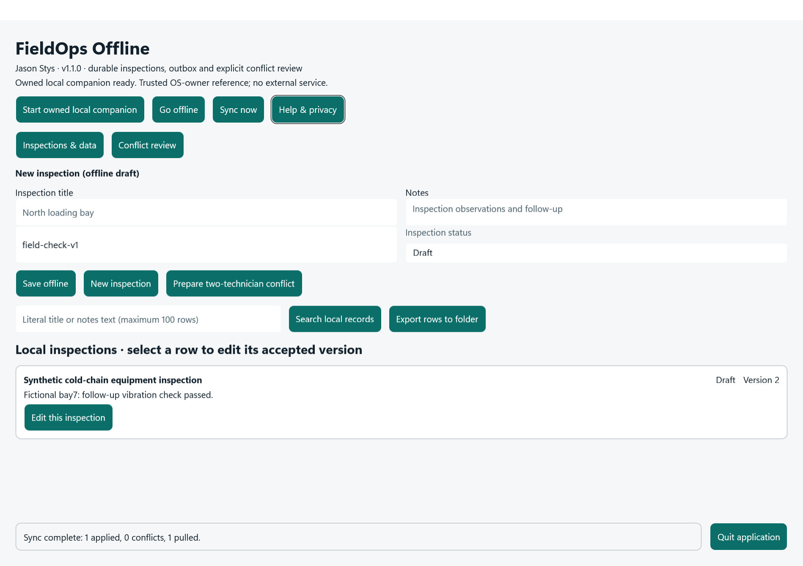
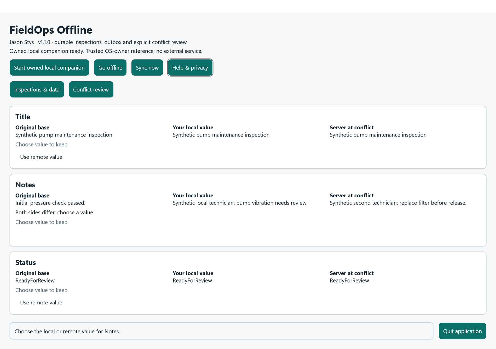

# FieldOps Offline native application

By Jason Stys. Version 1.1.0 is a genuine Windows .NET MAUI/WinUI application using the original
SQLite inspection store, transactional outbox, conflict resolver and ASP.NET Core sync protocol.
The prepared two-technician example is data inside this same application.

## Open and use the complete application

Extract the entire Windows x64 ZIP into a writable application folder. Open `FieldOps.App.exe`;
keep all adjacent files. The self-contained package includes .NET/ASP.NET Core 10.0.15 and Windows
App SDK runtime files. It requires no separately installed .NET SDK, Java, Python, IDE or development
commands. This is an unsigned unpackaged application, not an MSIX installer; Windows may display
publisher warnings. Windows x64 is the tested native distribution. No clean-machine or signed
package claim is made. Source Android builds remain a separate CI gate.

1. Enter an inspection title, notes, template and status; select **Save offline**. Empty titles are
   rejected. SQLite and the queued mutation are committed together.
2. **Start owned local companion** explicitly starts the actual reference sync API on its own fresh
   loopback port. The application never adopts an unrelated service on port 5080. Select **Sync now**
   to obtain an accepted version. **Go offline** stops the owned service and retains your drafts.
3. Use **Edit this inspection** to retain a row's ID and accepted version. Saving queues a revision;
   it does not create a second record. **New inspection** clears the editor deliberately.
4. **Prepare two-technician conflict** creates fictional pump inspection data through real SQLite
   and actual HTTP writes. Open **Conflict review**, inspect original/local/server values, choose
   divergent fields, **Save resolution offline**, then sync the fresh version-checked mutation.
   Missing choices are refused; cancel preserves both copies. A newer remote edit requires review
   again. Prepared data never replaces your existing records.
5. Search literal title or notes text, at most 120 characters. The screen shows at most 100 rows;
   `%`, `_` and `*` are literal content, not wildcard instructions. This bounded content search scans
   local text; the original indexed prefix API remains available to code consumers.
6. **Export rows to folder** creates a new JSON file with the currently displayed rows. Existing
   files are not overwritten. This is a bounded visible-record export, not a full backup, outbox
   export or server-state archive.
7. **Help & privacy** explains the workflow and trust boundary. **Quit application** and the window
   close button wait for started local work and owned service shutdown before releasing the profile.
   Editors/actions are disabled during work and closing. A slow operation is not abandoned by
   destroying its window.





## Durable data and authority

The ordinary application preserves the original MAUI unpackaged storage identity and
`FileSystem.AppDataDirectory/fieldops.db`. The legacy manifest publisher value is deliberately
unchanged because MAUI uses it in the Windows AppData path; displayed author/product attribution is
Jason Stys. The application does not reset or move an existing database.

The same profile contains `native-authority.txt`, `native-app.lock` and the
`native-companion/` directory (generation marker, `checkpoint.json`, owner lock). The native API
checkpoint retains accepted records, change cursors and idempotency outcomes. The standalone
development API still uses its original in-memory default unless explicitly composed with a
checkpoint.

An existing accepted client database cannot silently attach to a newly empty or different local
authority. A generation mismatch, regressed cursor, malformed/missing checkpoint or linked state is
refused and preserved. Unsynchronized version-zero drafts can explicitly pair with a new local
companion. A legacy database already synchronized with an external development API needs that
original authority; this version does not implement a production endpoint/account migration screen.

For a consistent backup, close the application normally and copy the entire profile, including the
SQLite main/WAL/SHM files if present, attachments, authority file and complete companion directory.
Restore the matching set while the app is closed. Never reset only the server or restore a partial
set to bypass an authority error. JSON row export is not a substitute for this backup.

## Security and limits

This is a single trusted OS-owner reference application. Device labels and prepared actors are
assertions, not authenticated people or enterprise roles. The fresh native service uses an ephemeral
capability, literal loopback binding, exact Host/Origin checks, strict JSON and bounded requests;
it adds no public service, ads, analytics or external API. Another process running as the same OS
owner can read local plaintext data; application encryption, tenant isolation and production
identity provisioning remain unimplemented. Use synthetic records.

Checkpoint state is capped at 8 MiB and 10,000 entries per collection; the existing SQLite outbox
cap, sync page limits and attachment limits remain. A full checkpoint refuses another write and
restores in-memory state rather than pretending it persisted. Source attachment handling is not
exposed as a native attachment picker. There is no background synchronization, automatic scheduler,
mobile device certification or universal close-time guarantee.

## Build and reproduce actual native acceptance

With the Windows .NET MAUI workload already installed:

```powershell
pwsh -NoProfile -File tests/native-archive.tests.ps1
pwsh -NoProfile -File scripts/build-native.ps1 -Output release/windows/bundle
pwsh -NoProfile -File scripts/archive-native.ps1 -Bundle release/windows/bundle -Proof artifacts/native/windows
```

Use a clean source tree. `-AllowDirty` is available only for explicitly labelled development
candidates; such metadata is not exact committed-source attestation. The build pins runtime packs
10.0.15, verifies their NuGet signatures and exact shipped runtime bytes, and includes dependency
notices plus `SOURCE.json`. Hosted builds pin SDK 10.0.404. The observed local SDK is 10.0.403 with
existing workloads; installing/updating global SDKs is not part of the build script.

The ZIP test first validates every entry/path/budget, extracts the complete archive into a new
owned directory, then launches its real EXE twice with only System32 on PATH. Marked synthetic
profiles are selected before the normal AppData path is evaluated. Actual MAUI controls exercise
offline save/retry, real HTTP acceptance, version-preserving editing, divergent conflict refusal,
four field choices, literal search, new-file export, restart and a held-operation Quit. Screenshots
come from that application's own WinUI render surface. The test separately checks process exit,
released file locks and absence of the former owned listening port. No user profile is read.

`Native application` CI retains only bounded JSON/PNG receipts by default for one day. A complete
unsigned ZIP is retained only after explicit trusted-main manual opt-in. Builds/tests are not a
public release or installed-PC acceptance; those require separate owner review.

## Primary references

- [MAUI Windows file storage](https://learn.microsoft.com/en-us/dotnet/maui/platform-integration/storage/file-system-helpers?view=net-maui-10.0)
- [AppWindow.Closing does not intercept programmatic Window.Close](https://learn.microsoft.com/en-us/windows/windows-app-sdk/api/winrt/microsoft.ui.windowing.appwindow.closing?view=windows-app-sdk-1.8)
- [Official .NET 10 release metadata](https://builds.dotnet.microsoft.com/dotnet/release-metadata/10.0/releases.json)
- [NuGet signature verification](https://learn.microsoft.com/en-us/nuget/reference/cli-reference/cli-ref-verify)
